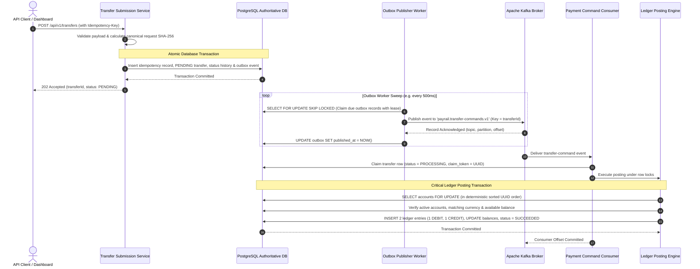

# PayRail — Distributed Payment Processing & Ledger Simulator

> ⚠️ **PayRail Synthetic Payment Simulator — no real money or bank connections.**
> 
> PayRail is a distributed payment-processing and double-entry ledger simulator built to demonstrate backend correctness, transactional outbox eventing, concurrency controls, idempotency, bounded recovery, and automated ledger reconciliation. **It must never connect to a real bank, payment network, card processor, or real customer funds.** All accounts, identities, balances, and transactions are fictional, synthetic data.

---

## Overview

In financial and ledger systems, distributed transactions across microservices or between databases and message brokers present significant correctness challenges: network partitions, dual-write inconsistencies, race conditions causing overdrafts, duplicate event delivery, and silent balance corruptions.

PayRail models a production-grade, distributed payment processing architecture addressing these failure modes:
- **PostgreSQL as Authoritative Source of Truth**: All financial balances, transfer states, immutable ledger entries, idempotency logs, and transactional outbox queues reside in PostgreSQL. Message brokers act strictly as transport.
- **Strict Decimal Arithmetic**: Monetary amounts are transmitted as decimal strings and computed using `BigDecimal` with two-decimal scale validation. Floating-point arithmetic (`float`, `double`, `parseFloat`) is strictly prohibited throughout backend and frontend.
- **Atomic Balanced Double-Entry Bookkeeping**: Every completed transfer atomically commits exactly one `DEBIT` and one `CREDIT` ledger entry equal in amount and currency, updating both account balances within a single database transaction.
- **Deterministic Row-Locking & Overdraft Prevention**: Account row locks are acquired in strictly sorted UUID order to prevent deadlocks under high concurrency. Database check constraints and transactional validations guarantee account balances never drop below zero.
- **Transactional Outbox Pattern**: Transfer submission commits the transfer state (`PENDING`) and outbox event atomically. Leased outbox workers publish events to Apache Kafka with bounded retries and backoff.
- **At-Least-Once Delivery with Consumer Claim-Fencing**: Kafka message delivery is assumed to repeat. Consumer handling uses lease claiming, monotonic state transition guards, and durable attempt audits to ensure idempotent execution.
- **Automated Discrepancy Reconciliation**: Periodic and on-demand reconciliation scans verify debit/credit conservation, opening balance plus net movement against current balance, and outbox backlogs without silently modifying immutable ledger history.
- **Operations Dashboard**: A responsive React + TypeScript dashboard providing real-time telemetry, transfer lifecycle inspection, audit logs, and operational controls while preserving read-only safety invariants.

---

## Architecture

### Component Architecture

```mermaid
flowchart TB
    subgraph ClientLayer [Client & Operations Interface]
        WebUI["React 19 + TypeScript Operations Dashboard<br/>(Vite, Strict Decimal Display, Bounded Polling)"]
        APIClient["API Clients / Automated Scripts<br/>(cURL, Integration Test Runners)"]
    end

    subgraph BackendLayer [Spring Boot 3.4 Application Modular Monolith]
        RESTController["REST API Controllers<br/>(/api/v1/accounts, /transfers, /ops)"]
        TransferService["Transfer Submission Service<br/>(Idempotency Hashing & Atomic Outbox Write)"]
        OutboxWorker["Transactional Outbox Publisher<br/>(Leased Claiming, Bounded Retries)"]
        EventConsumer["Payment Command Consumer<br/>(Claim-Fenced Execution & Deduplication)"]
        LedgerProcessor["Ledger & Posting Engine<br/>(Deterministic UUID Locking, Atomic Double-Entry)"]
        ReconciliationEngine["Continuous Reconciliation Engine<br/>(Audit Scans & Non-Mutating Discrepancy Reports)"]
        HealthProbes["Spring Actuator & Micrometer<br/>(/health, /prometheus, JSON Logging)"]
    end

    subgraph StorageLayer [Authoritative State & Transport]
        PostgresDB[("PostgreSQL 16 Authoritative Store<br/>- Accounts & Balances (CHECK current_balance >= 0)<br/>- Transfers & Status History<br/>- Append-Only Double-Entry Ledger<br/>- Transactional Outbox & Idempotency Records<br/>- Reconciliation Runs & Audit Issues")]
        KafkaBroker[("Apache Kafka 3.8 Broker (KRaft Mode)<br/>- payrail.transfer-commands.v1<br/>- payrail.transfer-commands.dlq.v1")]
    end

    WebUI -->|HTTP / JSON (Proxied)| RESTController
    APIClient -->|HTTP / JSON + Idempotency-Key| RESTController
    RESTController --> TransferService
    TransferService -->|Atomic Write| PostgresDB
    OutboxWorker -->|Leased Claim| PostgresDB
    OutboxWorker -->|Publish Event| KafkaBroker
    KafkaBroker -->|Consume Event| EventConsumer
    EventConsumer --> LedgerProcessor
    LedgerProcessor -->|SELECT ... FOR UPDATE & Atomic Commit| PostgresDB
    ReconciliationEngine -->|Read-Only Invariant Scans| PostgresDB
    RESTController --> ReconciliationEngine
    RESTController --> HealthProbes
    HealthProbes --> PostgresDB
    HealthProbes --> KafkaBroker
```

---

## Transfer Lifecycle & State Machine

Every transfer moves through a strictly validated lifecycle:

```mermaid
stateDiagram-v2
    [*] --> PENDING: POST /api/v1/transfers (Accepted & Outbox Written)
    
    PENDING --> PROCESSING: Worker claims transfer with lease token
    
    PROCESSING --> SUCCEEDED: Funds verified; 2 ledger entries + balances committed
    PROCESSING --> FAILED: Business decline (e.g. INSUFFICIENT_FUNDS, INACTIVE_ACCOUNT)
    PROCESSING --> PENDING: Transient failure (retried with exponential backoff)
    PROCESSING --> FAILED: Max retry attempts exhausted (routed to DLQ outbox)
    
    SUCCEEDED --> [*]: Terminal State (Immutable)
    FAILED --> [*]: Terminal State (Immutable)
```



---

## Event Flow & Transactional Outbox



---

## Non-Negotiable Invariants

1. **Authoritative State in PostgreSQL**: Balances, ledger entries, and outbox states are never kept in memory, in Kafka, or in browser state.
2. **Zero Binary Floating-Point**: Amounts use `BigDecimal` with scale 2 and PostgreSQL `NUMERIC(19,2)`. Serialized as decimal strings (`"150.00"`).
3. **Double-Entry Equilibrium**: Every completed transfer creates exactly one `DEBIT` and one `CREDIT` entry equal in amount and currency (`SUM(debit) == SUM(credit)`).
4. **Non-Negative Balances**: Database check constraints (`CHECK (current_balance >= 0)`) and transactional row-locks enforce that accounts can never spend below zero.
5. **Durable Idempotency**: Replaying an identical request with the same `Idempotency-Key` returns the original transfer. Reusing a key with a conflicting payload returns `409 IDEMPOTENCY_KEY_REUSED`.
6. **Dual-Write Safety**: Transfers and their outbound commands are committed to the transactional outbox in the same database transaction.
7. **At-Least-Once & Deduplicated**: Kafka consumers expect duplicate deliveries; processing is idempotent, claim-fenced, and guarded against terminal states.
8. **Append-Only Immutability**: Committed ledger entries and account opening baselines are never updated or deleted; triggers reject mutation attempts.
9. **Non-Mutating Reconciliation**: Reconciliation audits identify and log discrepancies, but never silently alter ledger records or balances.
10. **Synthetic Data Only**: Completely isolated from real banks, networks, or credentials.

---

## Prerequisites

- **Java**: Java 21 LTS (Eclipse Temurin recommended)
- **Maven**: Maven 3.9+ (or use the included `./mvnw` / `mvnw.cmd` wrapper)
- **Node.js**: Node.js 22 LTS & npm 10+
- **Docker**: Docker Engine 24+ and Docker Compose v2+

---

## Getting Started

### Option 1 — Full Containerized Stack (Recommended for Demo)

Run the entire application, PostgreSQL database, and Kafka broker via Docker Compose:

```bash
# 1. Clone repository
git clone https://github.com/GouravSharma26/PayRail.git
cd PayRail

# 2. Start PostgreSQL, Kafka, and containerized Backend with health checks
docker compose --profile app up -d --build --wait

# 3. Verify container health status
docker compose --profile app ps
```

The services will be available at:
- **Backend API**: `http://localhost:8080`
- **Actuator Health**: `http://localhost:8080/actuator/health`
- **Prometheus Metrics**: `http://localhost:8080/actuator/prometheus`
- **PostgreSQL**: `localhost:5432` (`payrail_db`, `payrail_user`, `payrail_secret`)
- **Apache Kafka**: `localhost:9092`

To start the frontend dashboard alongside the stack:
```bash
cd frontend
npm install
npm run dev
```
Access the dashboard at `http://localhost:5173`.

To stop and remove containers and volumes:
```bash
docker compose --profile app down -v
```

---

### Option 2 — Local Development Mode

Run dependencies in Docker and backend/frontend directly on your host:

```bash
# 1. Start PostgreSQL 16 and Kafka 3.8
docker compose up -d

# 2. Run backend via Maven Wrapper
./mvnw spring-boot:run -pl backend
# (On Windows PowerShell: .\mvnw.cmd spring-boot:run -pl backend)

# 3. In a separate terminal, start frontend
cd frontend
npm install
npm run dev
```

---

## Step-by-Step Verification Walkthrough

Execute the following commands to reproduce all core scenarios against a running stack (`http://localhost:8080`).

### 1. Health & Readiness Verification

```bash
# Verify system readiness (PostgreSQL + Kafka)
curl -s http://localhost:8080/actuator/health/readiness | jq .

# Verify operational diagnostics summary
curl -s http://localhost:8080/api/v1/ops/health/summary | jq .
```

Expected Response:
```json
{
  "status": "UP",
  "dbStatus": "UP",
  "kafkaStatus": "UP",
  "outboxBacklog": 0,
  "lastReconciliationStatus": "CLEAN",
  "openReconciliationIssues": 0
}
```

---

### 2. Create Synthetic Accounts

```bash
# Create Account A (Opening Balance: 500.00 INR)
curl -s -X POST http://localhost:8080/api/v1/accounts \
  -H "Content-Type: application/json" \
  -d '{"displayName":"Synthetic Treasury A","currency":"INR","openingBalance":"500.00"}' | jq .

# Create Account B (Opening Balance: 100.00 INR)
curl -s -X POST http://localhost:8080/api/v1/accounts \
  -H "Content-Type: application/json" \
  -d '{"displayName":"Synthetic Treasury B","currency":"INR","openingBalance":"100.00"}' | jq .
```

---

### 3. Idempotent Transfer Submission & Duplicate Replay

Submit a transfer of `150.00 INR` with an `Idempotency-Key`:

```bash
# Submit initial transfer
curl -s -X POST http://localhost:8080/api/v1/transfers \
  -H "Content-Type: application/json" \
  -H "Idempotency-Key: demo-key-0001" \
  -d '{
    "sourceAccountId": "<ACCOUNT_A_UUID>",
    "destinationAccountId": "<ACCOUNT_B_UUID>",
    "amount": "150.00",
    "currency": "INR"
  }' | jq .
```

*Response `202 Accepted`:*
```json
{
  "id": "a5d4d4f8-fc05-4834-af22-181cd3bb0fae",
  "status": "PENDING",
  "amount": "150.00",
  "currency": "INR"
}
```

**Replay identical request with same key:**
```bash
curl -s -X POST http://localhost:8080/api/v1/transfers \
  -H "Content-Type: application/json" \
  -H "Idempotency-Key: demo-key-0001" \
  -d '{
    "sourceAccountId": "<ACCOUNT_A_UUID>",
    "destinationAccountId": "<ACCOUNT_B_UUID>",
    "amount": "150.00",
    "currency": "INR"
  }' | jq .
```
*Result: Returns the exact same transfer record without creating a duplicate transfer or outbox event.*

---

### 4. Idempotency Key Conflict Protection

Reusing the key with a different payload (e.g. amount `250.00`):

```bash
curl -s -w "\nHTTP Status: %{http_code}\n" -X POST http://localhost:8080/api/v1/transfers \
  -H "Content-Type: application/json" \
  -H "Idempotency-Key: demo-key-0001" \
  -d '{
    "sourceAccountId": "<ACCOUNT_A_UUID>",
    "destinationAccountId": "<ACCOUNT_B_UUID>",
    "amount": "250.00",
    "currency": "INR"
  }' | jq .
```

*Result:* `409 Conflict` with error code `IDEMPOTENCY_KEY_REUSED`.

---

### 5. Inspect Completed Transfer & Balanced Ledger Legs

```bash
# Query transfer details
curl -s http://localhost:8080/api/v1/transfers/<TRANSFER_UUID> | jq .

# Inspect atomic double-entry ledger legs
curl -s http://localhost:8080/api/v1/transfers/<TRANSFER_UUID>/ledger | jq .

# Verify updated account balances
curl -s http://localhost:8080/api/v1/accounts/<ACCOUNT_A_UUID> | jq .
curl -s http://localhost:8080/api/v1/accounts/<ACCOUNT_B_UUID> | jq .
```

*Account A balance is now `350.00 INR`; Account B balance is `250.00 INR`.*

---

### 6. Overspend / Insufficient Funds Protection

Attempt to transfer `9999.00 INR` from Account A (which only has `350.00`):

```bash
curl -s -X POST http://localhost:8080/api/v1/transfers \
  -H "Content-Type: application/json" \
  -H "Idempotency-Key: demo-key-overspend-1" \
  -d '{
    "sourceAccountId": "<ACCOUNT_A_UUID>",
    "destinationAccountId": "<ACCOUNT_B_UUID>",
    "amount": "9999.00",
    "currency": "INR"
  }' | jq .

# Wait 2s and inspect final state
curl -s http://localhost:8080/api/v1/transfers/<OVERSPEND_TRANSFER_UUID> | jq .
```

*Result:* Transfer reaches terminal `FAILED` with safe failure code `INSUFFICIENT_FUNDS`. Account balances remain completely untouched and zero ledger entries are written.

---

### 7. Transient Broker Outage & Autonomous Recovery

Simulate an unexpected Kafka broker crash:

```bash
# Stop Kafka broker
docker stop payrail-broker

# Submit transfer while Kafka is completely down
curl -s -X POST http://localhost:8080/api/v1/transfers \
  -H "Content-Type: application/json" \
  -H "Idempotency-Key: demo-broker-outage-key" \
  -d '{
    "sourceAccountId": "<ACCOUNT_A_UUID>",
    "destinationAccountId": "<ACCOUNT_B_UUID>",
    "amount": "50.00",
    "currency": "INR"
  }' | jq .
```

*Result:* The API returns `202 Accepted` with status `PENDING` because the transfer and its outbox command are safely persisted in PostgreSQL.
Check outbox status:
```bash
curl -s http://localhost:8080/api/v1/ops/outbox/status | jq .
# totalUnpublished shows 1
```

Now recover the broker:
```bash
docker start payrail-broker
```
*Result:* As soon as Kafka recovers, the leased outbox publisher claims the event, publishes it to the broker, the consumer processes the payment, and the transfer status automatically reaches `SUCCEEDED` with balanced ledger postings!

---

### 8. Reconciliation Audit Scan

Trigger an immediate on-demand reconciliation audit:

```bash
curl -s -X POST http://localhost:8080/api/v1/ops/reconciliation/trigger | jq .

# List recent reconciliation audit runs
curl -s "http://localhost:8080/api/v1/ops/reconciliation/runs?limit=5" | jq .
```

*Result:* Status `CLEAN`, `openIssues: 0`.

---

## Test Verification & Evidence

### Local Test Execution

#### Backend Test Suite (JUnit 5 + Testcontainers)
```bash
./mvnw -B verify
# (Windows: .\mvnw.cmd -B verify)
```
- **Results**: **167 tests passed**, 0 failures, 0 errors, 0 skipped.
- **Coverage**: Unit tests, concurrency race-condition tests, row-locking deadlock prevention, Testcontainers PostgreSQL 16 & Kafka 3.8 integration tests, DLQ processing, stale lease recovery, outbox publisher crash recovery, metrics serialization, and Flyway migration tests.

#### Frontend Test Suite (Vitest + JSDOM)
```bash
cd frontend
npm run lint       # ESLint 9 (0 errors, 0 warnings)
npm run typecheck  # TypeScript ~5.7.2 (0 errors)
npm test           # Vitest run (29 tests passing across 6 suites)
npm run build      # Vite production build (318 kB JS bundle)
```
- **Results**: **29 tests passed**, 0 failures.
- **Coverage**: Persistent synthetic warning banner on all routes, string-safe decimal formatters (asserting `parseFloat` is never invoked), status filtering, pagination, empty/error states, transfer detail status timelines, bounded live polling with unmount cleanup, and read-only operational safety checks.

---

### GitHub Actions CI Verification

Continuous integration runs automatically on every push to `main` across four parallel jobs:
1. **Frontend Lint, Typecheck, Test & Build**: Node.js 22, `npm ci`, lint, typecheck, tests, and build.
2. **Build & Test (JDK 21)**: Java 21 Temurin, Maven Wrapper, full Testcontainers verification suite.
3. **Validate Docker Compose**: Validates `docker-compose.yml` against `--profile all`.
4. **Build Backend Docker Image & Smoke Test**: Docker Buildx builds `backend/Dockerfile` and boots full stack with `--profile app --wait`.

- **Latest Verified CI Run**: [https://github.com/GouravSharma26/PayRail/actions/runs/40188533660](https://github.com/GouravSharma26/PayRail/actions/runs/40188533660)
- **Status**: **Success** (All 4 jobs passed)

---

## Known Limitations & Design Boundaries

- **Single Currency Transfers**: Transfers are supported only between accounts sharing the exact same currency code (e.g. `INR` to `INR`). FX exchange rates and currency conversion are explicitly out of scope for this simulator.
- **Synthetic Opening Balances**: Account opening balances serve as synthetic baseline starting conditions; they are not deposits from external banking rails.
- **Restricted Public Account Creation**: The dashboard deliberately omits public account creation controls to adhere to PayRail security invariants against unrestricted unauthenticated writes.
- **Read-Only Operational Controls**: The Reconciliation and Operations views are strictly read-only diagnostics; automatic balance repair, direct ledger tampering, and unauthenticated DLQ message replaying are prohibited by design.

---

## License

This project is open-source under the Apache License 2.0.
