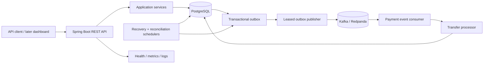
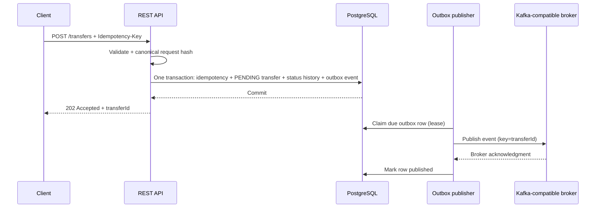

# Architecture and Component Boundaries

## 1. Architecture overview

Start with a **modular monolith**: one Spring Boot deployable, one PostgreSQL database, and a Kafka-compatible broker. Separate code by business capability, not by deploying premature microservices. The background outbox publisher, payment consumer, retry scheduler, and reconciliation scheduler may run as Spring-managed processes in the same application for the MVP. All rely on PostgreSQL for durable coordination so multiple application instances can safely compete for work.

## 2. Modules / packages

Use a package root such as `com.payrail` (or another short organization-independent namespace) and modules/packages similar to:

- `account`: synthetic account creation, account lookup, balance view, account active/inactive state.
- `transfer`: submission, lifecycle, query/search, request hash/idempotency handling.
- `ledger`: immutable postings and invariant validation.
- `outbox`: durable event creation, leases, publication state.
- `messaging`: broker event schema, publisher, consumer, deduplication, retry/DLQ orchestration.
- `reconciliation`: scheduled checks, reports, issue records, manual read APIs.
- `observability`: correlation IDs, structured logging, metrics, health groups.
- `common`: error model, clock abstraction, IDs, validation helpers; keep this small.

Controllers must not contain SQL or ledger rules. DTOs must not be database row types. Keep the critical write path easy to trace across a small number of services.

## 3. Data ownership

PostgreSQL is the source of truth for:
- Idempotency key records and request hashes.
- Transfer lifecycle/status history and processing attempts.
- Account opening/current cached balances.
- Ledger entries.
- Outbox and consumer deduplication records.
- Reconciliation run results and issues.

Kafka/Redpanda is transport, not the authoritative state store. The dashboard is a read client and must not calculate/modify authoritative balances. Application caches are optional and must never affect correctness.

## 4. Transfer submission sequence

If the API response is lost after commit, a retry with the same idempotency key returns the original transfer. If publication succeeds but the outbox row is not marked published due to a crash, it may be published again; consumer deduplication and transfer state guards make that safe.

## 5. Processing sequence

The consumer acknowledges an event only after durable handling is complete. Claim/lease work and the final ledger transaction must be explicitly designed so a process crash cannot leave a transfer permanently unclaimable. For MVP, use a short claim transaction with a unique claim token and expiry; then process in a database transaction. A scheduled recovery task finds expired leases and emits/schedules a retry.

The final success transaction must include:
1. Lock and re-read the transfer row.
2. Confirm the transfer is still eligible and claim token matches.
3. Lock source/destination account rows in deterministic ID order.
4. Validate account state, same currency, positive amount, and source funds.
5. Update cached balances.
6. Insert debit and credit ledger rows.
7. Record status transition to `SUCCEEDED` and attempt outcome.
8. Insert processed-event deduplication record.
9. Commit all together.

A business decline, such as insufficient funds, is a committed `FAILED` outcome without ledger postings. Infrastructure exceptions roll back the posting transaction; a separate, short retry-scheduling transaction records the error safely, releases or expires the claim, inserts a future retry outbox event, and marks the original event handled atomically. If the retry limit is exhausted, mark the transfer `FAILED` with a technical-exhaustion failure code and raise a DLQ/operational finding. Never label an infrastructure error as a successful transfer.

## 6. Transaction boundaries

- Submission transaction: idempotency record + transfer + initial status history + outbox event.
- Claim transaction: short row lock; write claim token/lease and attempt metadata; commit quickly.
- Success/final-business-result transaction: account locks + balance changes + ledger pair + terminal transfer status/history + event deduplication. All or nothing.
- Retry scheduling transaction: attempt outcome + `PROCESSING -> PENDING` (or technical terminal failure at the cap) + retry outbox event + original event dedupe record. All or nothing.
- Outbox publication: claim rows with a lease in one DB transaction; publish outside the DB transaction; mark published after broker acknowledgment in another transaction. Duplicates are expected after a crash between publish and marking.
- Reconciliation: read consistent snapshots where practical and record findings separately. It must not mutate ledger entries or automatically set a transfer to success.

Do not call a remote broker while holding a long account/ledger transaction open.

## 7. Runtime components

- REST API: validates commands, returns `202 Accepted` when a new transfer has been durably accepted, not when it is settled.
- Outbox publisher: claims unsent/due outbox rows with `FOR UPDATE SKIP LOCKED` or an equivalent safe lease protocol. Use bounded batches.
- Consumer: parse/version-check envelope, dedupe by consumer and event ID, claim the transfer, process or schedule retry, and acknowledge only after commit.
- Retry scheduler/recovery sweep: identify expired processing leases and retryable failed publication attempts; create durable retry work, not in-memory timers only.
- Reconciliation scheduler: periodically validates ledger pair integrity, per-currency balance, cached account balance, stale processing transfers, and outbox backlog; writes immutable per-run findings.
- Actuator/metrics: health and operational signals, with no sensitive data in labels.

## 8. Scalability and operability constraints

- Support multiple backend instances without relying on process-local locks.
- Use DB row locking and unique constraints as the correctness boundary.
- Use stable event schemas with `schemaVersion`, `eventId`, `eventType`, `occurredAt`, `aggregateId`, `correlationId`, and a small payload.
- Partition broker events by transfer ID to preserve per-transfer ordering where useful; still assume duplicates and retries.
- Keep query pagination bounded and indexed. Avoid full-table scans on every API call.
- Record outbox age, retry counts, consumer error counts, stale leases, transfer outcomes, and reconciliation issue counts.
