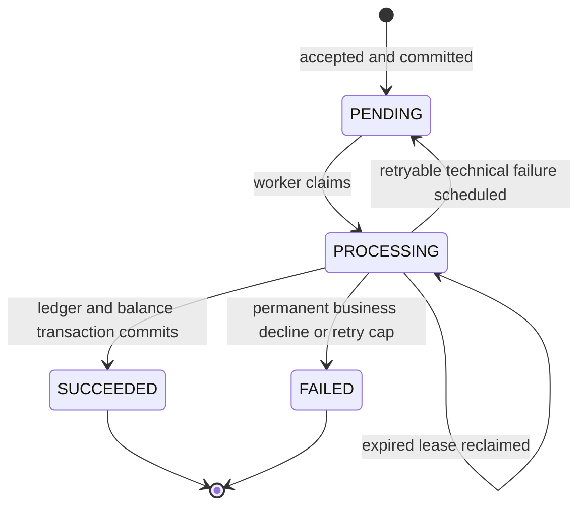

# Domain Model and State Invariants

## 1. Scope and terminology

PayRail simulates internal transfers between fictional accounts. It does not move actual money. The API uses a decimal string for amounts; the backend converts to validated `BigDecimal` values and persists them in PostgreSQL `NUMERIC(19,2)`. MVP supports two-decimal currencies only. Reject amounts with more than two fractional digits; do not round silently.

## 2. Entities

### Account

- `id`: UUID.
- `display_name`: synthetic label only; no real personal data.
- `currency`: uppercase three-character code, e.g. `INR`, `USD`, or `EUR` (test data may use these codes without claiming currency conversion).
- `opening_balance`: immutable synthetic baseline, >= 0.
- `current_balance`: cached current balance, updated in the same transaction as ledger postings.
- `status`: `ACTIVE` or `INACTIVE`.
- `created_at`, `updated_at`: UTC timestamps.

MVP has no FX, overdraft, fees, holds, reversals, card payments, external beneficiaries, or user identity model. An account is never permitted to spend below zero.

### Transfer

- `id`: UUID.
- `source_account_id`, `destination_account_id`: different account IDs.
- `amount`: strictly positive, two-decimal value.
- `currency`: must equal the currency on both accounts.
- `status`: `PENDING`, `PROCESSING`, `SUCCEEDED`, or `FAILED`.
- `failure_code`, `failure_message`: nullable, stable code plus safe non-sensitive explanation.
- `created_at`, `updated_at`, `completed_at`.
- `processing_attempt_count`, `processing_lease_until`, `processing_claim_token`: internal recovery fields as appropriate.
- `correlation_id`: request/workflow correlation ID.

### Idempotency record

Stores client-supplied `Idempotency-Key`, canonical request hash, transfer ID, creation timestamp, and optional API version. The key must be unique for the application scope. It is not an authorization credential.

### Ledger entry

Append-only posting attached to a transfer. Each successful transfer has exactly two transfer ledger legs: one `DEBIT`, one `CREDIT`. Both contain transfer ID, account ID, amount, currency, and creation time. The pair must have equal amount/currency. Unique `(transfer_id, leg)` protects against duplicate postings. Ledger entries cannot be updated or deleted by application code.

Opening balances are synthetic initial conditions recorded on the account as an immutable baseline for this simulator; they are not transfer postings. Reconciliation compares `current_balance` to `opening_balance + credits - debits` for all committed transfer entries. Explicitly disclose this simplification in the README. Do not label opening balances as deposits from a real source.

### Transfer status history

Append-only sequence of status changes with transfer ID, prior status, new status, reason code, timestamp, correlation ID, and optional attempt number. Include all committed transitions, including retries back to `PENDING`. A transaction rollback must not leave a history record for an uncommitted state.

### Processing attempt

Records each durable attempt's number, claim token, start/finish time, outcome (`IN_PROGRESS`, `SUCCEEDED`, `BUSINESS_FAILED`, `RETRY_SCHEDULED`, `EXHAUSTED`), stable error code, sanitized message, and elapsed time if known. Store stack traces only in restricted logs, never in the API response.

## 3. State machine

Rules:
- New transfer starts `PENDING` only after the submission transaction commits.
- `SUCCEEDED` and `FAILED` are terminal.
- No direct transition from `PENDING` to `SUCCEEDED` that bypasses ledger posting.
- `FAILED` due to a business decline has no transfer ledger postings.
- A technical failure can retry only within a configured bounded attempt count and backoff policy. After exhaustion, store a stable technical failure code and make the event visible to operators.
- Reprocessing a terminal transfer is a no-op with an audit/metric signal; it must never create a second pair of ledger entries.

## 4. State and accounting invariants

1. `amount > 0`.
2. Source and destination account IDs differ.
3. Source and destination currencies equal the transfer currency.
4. Only `ACTIVE` accounts can send/receive in the MVP.
5. A transfer cannot spend from an account whose current balance is less than the amount.
6. For each `SUCCEEDED` transfer: exactly two ledger entries exist, one debit and one credit, equal amount/currency, applied to source/destination respectively.
7. For each non-successful transfer: no transfer ledger entries exist.
8. For each account: `current_balance = opening_balance + sum(CREDIT) - sum(DEBIT)` over committed transfer postings for that account/currency.
9. No committed ledger row is updated or deleted.
10. No more than one ledger debit and one ledger credit are committed per transfer.
11. Each API idempotency key maps to one canonical request hash and one transfer.
12. If an idempotency key is retried with the same request, do not create another transfer/outbox event. If the request differs, return conflict.
13. Balance changes, ledger pair, successful status, status history, and consumer dedupe record must commit atomically.
14. Retry/outbox work must be durable before the consumer acknowledges the original event.

## 5. Failure taxonomy

### Permanent business failures

- `SOURCE_ACCOUNT_NOT_FOUND`
- `DESTINATION_ACCOUNT_NOT_FOUND`
- `ACCOUNT_INACTIVE`
- `CURRENCY_MISMATCH`
- `INSUFFICIENT_FUNDS`
- `INVALID_TRANSFER` (same source/destination, invalid amount/scale)

Validate request-shape failures synchronously before creating a transfer where possible (e.g. non-positive amount). Account state and balance can change between submit and process, so those checks must also be performed in the processing transaction and can result in a `FAILED` transfer.

### Retryable technical failures

Database unavailable, serialization/deadlock/transient SQL failure, broker outage, temporary application dependency failure, or controlled transient fault injection. Do not retry permanent business failures. Retry only bounded times with backoff and jitter; persist the retry decision.

### Operations findings

Stale processing lease, old pending transfer, outbox publication age threshold exceeded, event repeatedly failing, missing/imbalanced ledger legs, account balance mismatch, or unsupported event schema. Findings are records for investigation, not automatic financial repair.
